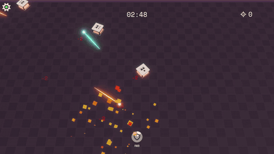
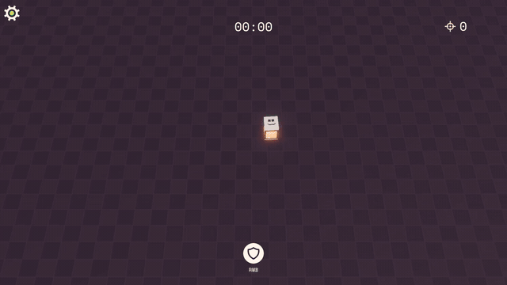
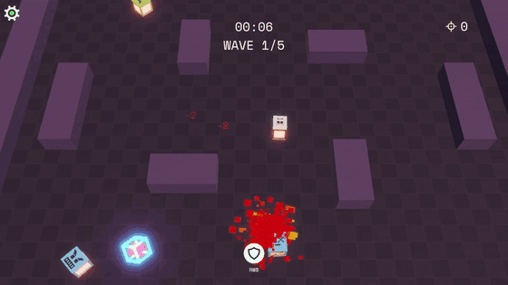
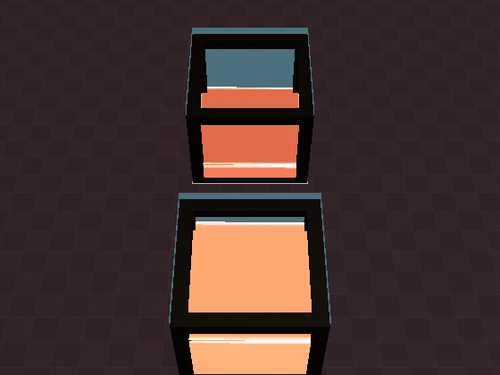
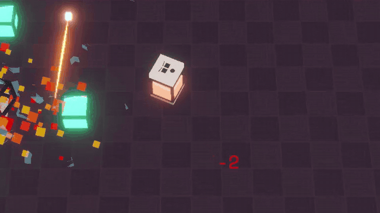

# Geometry Crunch — Code Samples

A selection of scripts from **Geometry Crunch**, a top-down arena shooter I'm building solo in **Unity 6** with **Photon Quantum 3** (deterministic, rollback-netcode ECS). The game is in alpha.

<p align="center">
  
</p>

**The core rule:** HP is your ammo. Every shot drains your own health, and a well-timed parry absorbs incoming bullets back as HP.

▶ [Watch the trailer](https://youtu.be/VAkPRMqpA74) · [LinkedIn](https://www.linkedin.com/in/milangordic3/) · milan.gordic3@hotmail.com

> The full project is private. These files are shared for code review and won't compile on their own: they depend on the Quantum SDK, generated code (from the `.qtn` files) and the rest of the project.

---

## How the code is organised

Quantum splits a game into two halves, and the folders here follow that split:

```
Simulation/   deterministic game logic: runs identically on every client, can be rolled back and re-simulated
  QTN/        data model (components, structs, events) — Quantum generates C# from these files
View/         Unity side: reads simulation state and draws it (shaders, UI, effects); never changes game state
```

Rules the simulation code follows:
- **Fixed-point math only** (`FP`, `FPVector2`). No `float`, no `UnityEngine.Random`, no `Time.deltaTime`.
- **All state lives in components**, so a rollback restores everything. Systems are stateless.
- **Randomness goes through `frame.RNG`**, iteration through Quantum's deterministic component iterators, and ties are broken explicitly.
- **The view only reads** `PredictedFrame` and reacts to events. Player intent enters the simulation as input or commands.

---

## The scripts

### Match flow, rematch and reconnects — [`GameManagerSystem.cs`](Simulation/Systems/GameManagerSystem.cs)



A state machine for the match: lobby countdown, bots filling empty seats, a timed match, then game over.

- **Play again:** each client sends a `CommandPlayAgain`. Votes are stored as a bitmask in the `GameManager` singleton, and the rematch starts once every *connected* human has voted. `StartRematch` resets the arena in place (bots, pickups, bullets, zone, spawn rotation, every player's stats), so the room never has to be recreated.
- **Return slots:** when a player drops, their stats are saved in a fixed array indexed by `PlayerRef`. If they rejoin within Photon's player TTL, they get a new avatar with the same kills and deaths.
- **Fair bot spread:** `PickDifficulty` distributes bots evenly across Easy, Normal and Hard for any bot count.

<br clear="right">

### Bot pathfinding — [`BotNavigation.cs`](Simulation/Bots/BotNavigation.cs)



Deterministic grid A* so bots path around cover instead of getting stuck on walls.

- **Walkability grid:** built once per map and bot radius from the map's baked static colliders, then cached. It depends only on baked data, so every client builds the same grid and it needs no rollback state.
- **Straight line first:** a bot-sized shape cast checks whether the goal is directly reachable. A* only runs when it isn't.
- **A\* itself:** 8-way with integer costs (10 and 14), no corner cutting, and a binary heap whose ties break by cell index, so the search order is identical on every client.
- **String pulling:** the bot heads for the furthest path node it can reach in a straight line, so paths look natural instead of grid-shaped. It re-plans every 0.5 s or when the goal moves.

<br clear="right">

### Bullets, parry and damage — [`BulletSystem.cs`](Simulation/Systems/BulletSystem.cs), [`PlayerDamageable.cs`](Simulation/Damage/PlayerDamageable.cs)

- **Bullets are swept circles** (`ShapeCastAll`), not zero-width rays, so shots that visually clip a cube actually hit. Hits are sorted by cast distance, so a wall in front of a player blocks the shot.
- **Parry:** a bullet hitting a parrying target becomes healing instead of damage.
- **`PlayerDamageable`** is the data-driven damage rule set:
  - **Credit:** damage dealt (excluding self-damage from shooting and the zone), kills, deaths and streaks.
  - **Death:** the avatar is marked dead instead of destroyed, so it can respawn, and its weapon drops one tier.
  - **Loot:** death scatters health pickups using integer RNG only.

### Liquid HP — [`LiquidSlosh.cs`](View/Liquid/LiquidSlosh.cs), [`LiquidHP.shader`](View/Liquid/LiquidHP.shader), [`LiquidSurface.shader`](View/Liquid/LiquidSurface.shader)

<p>
  
  
</p>

Health is shown as liquid inside a glass cube. This is view-side only: the simulation just owns the HP number.

- **Tilt:** a damped pendulum driven by **acceleration**, not velocity. Constant speed leaves the liquid level; starting, stopping and turning make it slosh. The rocking frequency follows the first slosh mode of a box, `ω² ∝ tanh(π·depth)`, so shallow liquid rocks more slowly, like real water.
- **Ripples:** a 12×12 heightfield running a damped wave equation at a fixed 120 Hz, with reflective walls. The mean is subtracted every step, so volume is conserved. Hits, parries and landings inject splashes.
- **Clamping:** the surface is scaled so it can never dip below a thin floor layer or rise past the lid. At low HP you see a shallow puddle, never an empty cube.
- **Shaders:** the body shader discards fragments above the surface to draw the waterline on the glass walls. A separate grid mesh draws the real top surface, with ripple normals exaggerated so small waves still catch the light.

### Parry cooldown icon — [`ParryCooldownUI.cs`](View/UI/ParryCooldownUI.cs)

A small HUD script that shows the view pattern. It reads the local player's `Parry` component from the predicted frame every view update and turns it into a radial fill: see-through during the parry window, refilling over the cooldown, with a short pop when it's ready again.

---

## Data model — [`Simulation/QTN`](Simulation/QTN)

- **`GameManager.qtn`:** match state, rematch votes, return slots.
- **`PlayerLinkAndInput.qtn`:** per-player stats and the input struct.
- **`Bot.qtn`:** AI state, including the pathfinding waypoint.

## Tech

Unity 6 (URP) · C# · Photon Quantum 3 (deterministic ECS, rollback netcode) · Photon Realtime · HLSL shaders · DOTween

---

© 2026 Milan Gordić. Shared for portfolio review only. All rights reserved; not licensed for reuse.
